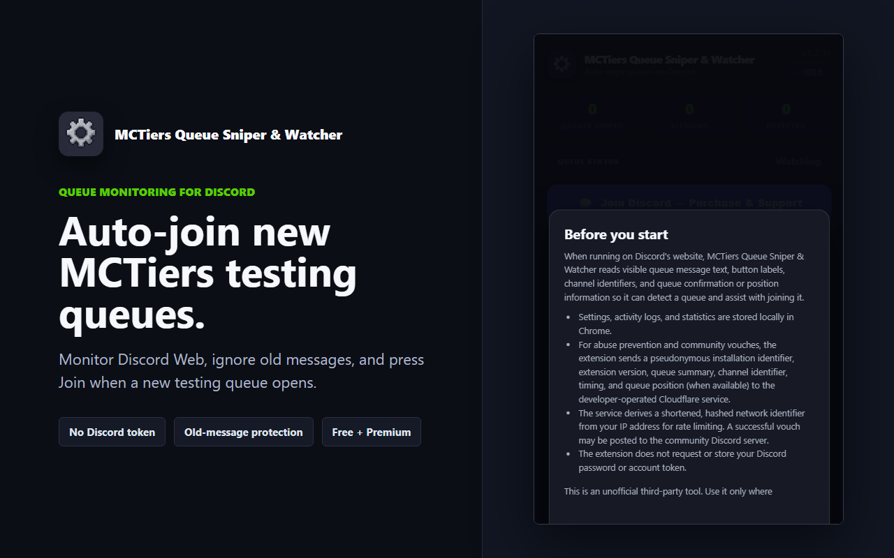

# Queue Monitor

A published Chrome extension for watching competitive Minecraft queues in Discord Web and joining when a new queue opens.

*Earlier interface, v1.2.11.*

## What it does

Queue Monitor detects new or edited queue posts, filters duplicates, tracks queue status, and can join a queue when it opens. It also includes activity logs and Chrome notifications.

I built and maintain the extension, which is used by **300+ people**. Its licensing backend uses Cloudflare Workers for validation and rate limits.

## Links and technology

- [Chrome Web Store](https://chromewebstore.google.com/detail/mctiers-queue-sniper-watc/aibcfnkajkoandabcpbebgaijomadkjn)
- **Stack:** JavaScript, Chrome APIs, Manifest V3, Cloudflare Workers
- **Source:** The production source repository is private. This case study contains no source code, credentials, customer data, or license keys.

Engineering notes

- Ignores queue posts already visible when monitoring starts.
- Handles both new posts and existing posts edited to add a Join button.
- Keeps settings and activity history on the device where possible.
- Does not request or collect Discord passwords or account tokens.

Building a useful extension required handling changing page content and repeated events carefully, while keeping the local browser experience separate from server-side licensing.

This is an unofficial third-party product and is not affiliated with Discord or MCTiers.
